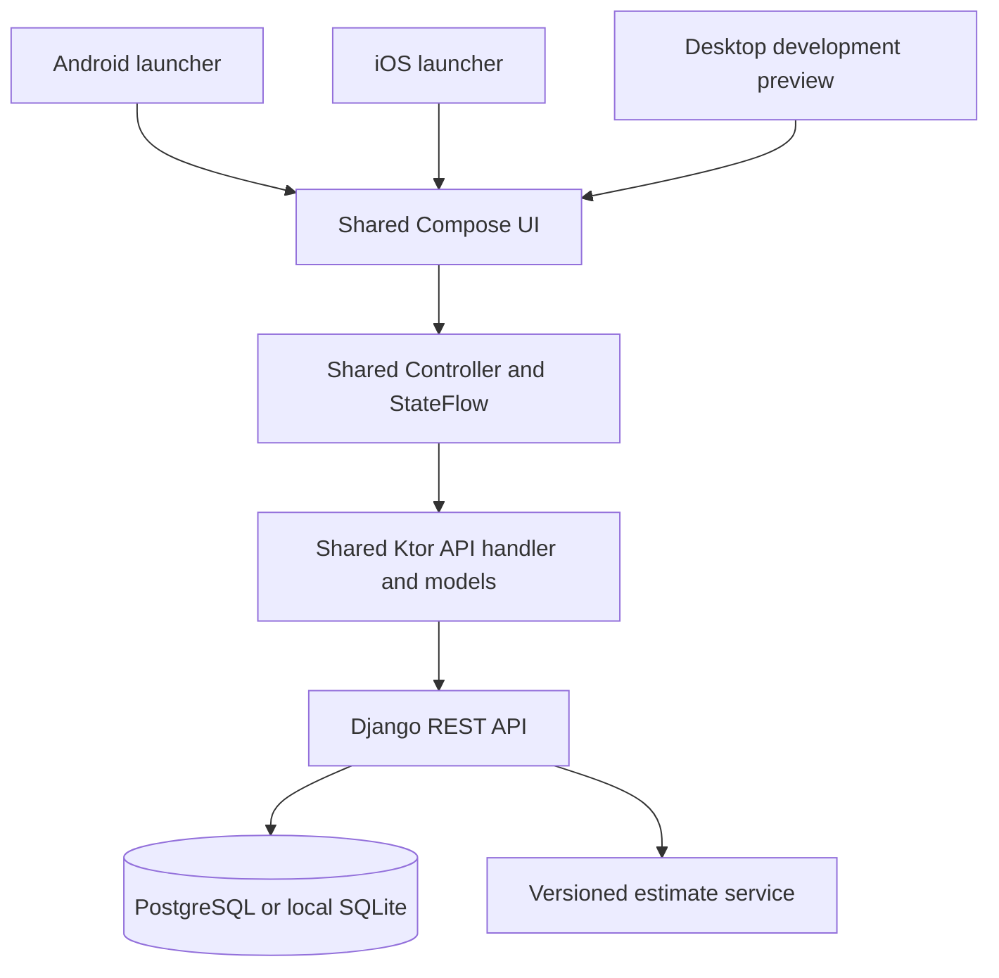

# Shared architecture

`commonMain` owns UI, form state, authentication, refresh handling, requests and responses. Platform source sets select the HTTP engine and supply the Android Activity or iOS UIViewController. Future OS-specific features belong behind common interfaces, with Health Connect on Android and HealthKit on iOS.

Django owns the health record and prediction rules. Both mobile platforms receive the same results, rather than maintaining duplicate prediction implementations. A future validated predictor can replace the simple median service through a versioned API.

The API always filters records by the authenticated user. Record IDs from other accounts return 404. Authentication uses Django password hashing and validation plus short-lived access tokens and rotating, blacklisted refresh tokens. Mobile currently stores tokens only in memory and does not log or persist credentials.

## Estimate behavior

Use logged period starts up to the profile's current local date. Compute the median number of days between consecutive starts; use the profile setting when there is no completed interval. Compute median inclusive duration from periods with an end date; otherwise use the period setting. Estimate the next start once from the latest logged start. An overdue date remains overdue, rather than being silently advanced to another cycle. Report the number of intervals and basis with every result.

This algorithm is a transparent starting point. It is not a validated fertility model or a reconstruction of Clue's backend.

## Local research

Clue 274.0 was inspected with REA and the hash-verified JADX headless engine. Static route declarations exposed account, onboarding, cycle, calendar, tracking, analysis, pregnancy, perimenopause, content, reminders, wearables, subscriptions, sharing and other areas. Prediction/analysis response models and API declarations were recovered, along with Room schema statements. The export reported decompilation errors, so it cannot establish complete behavior.

The APK and detailed local evidence remain separate from the new app. No original assets or decompiled source are shipped here. Reference tooling: [REA](https://github.com/morluto/rea), [Android analysis](https://github.com/morluto/rea/blob/main/docs/android-analysis.md). Shared UI support: [Kotlin Multiplatform platform status](https://kotlinlang.org/docs/multiplatform/supported-platforms.html).
